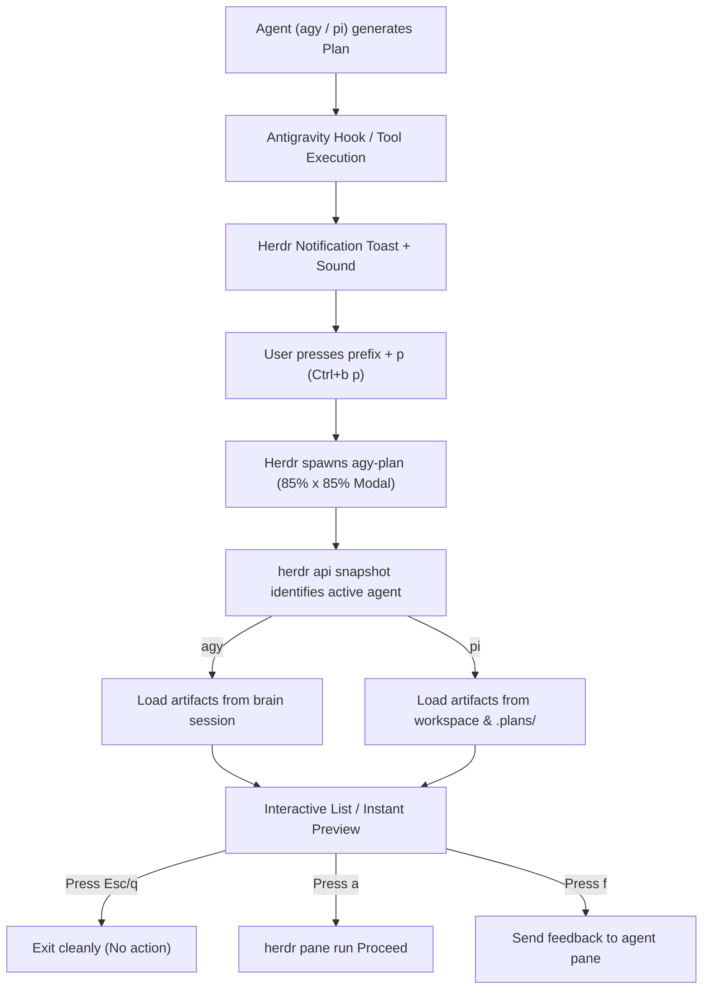

# agy-plan / pi-plan 📋⚡

[](LICENSE)
[](https://www.python.org/)
[](https://github.com/eugeniourueta/herdr)
[](https://github.com/charmbracelet/glow)

> **Terminal-native Markdown plan reviewer & approver for coding agents ([Antigravity](https://github.com) & [Pi](https://github.com/earendil-works/pi)) inside [Herdr](https://github.com) multiplexer.**

Inspect, review, and approve agent implementation plans without leaving your terminal or switching to VS Code.

---

## 💡 Why agy-plan?

When working inside a terminal multiplexer like **Herdr** with coding agents:
1. The agent stops and asks for feedback or approval on an implementation plan (`plan_*.md` or `walkthrough.md`).
2. Usually, you have to leave your terminal, open VS Code or a browser, find the hidden artifact directory, read it, and return to the terminal to type `Proceed`.
3. **agy-plan** fixes this: press **`Ctrl+b p`**, and an integrated **85% x 85% modal popup** appears with your formatted Markdown in full **Glow** color. Press **`a`** to approve (`Proceed`), **`f`** to send feedback, or **`Esc`** to dismiss instantly without performing any actions.

---

## ✨ Features

- 🖥️ **Herdr Modal Popup**: Bound to `prefix + p` (`Ctrl+b p`), spawning an instantaneous popup over your active agent pane.
- 🎨 **Rich Glow Markdown Rendering**: Headers, tables, diffs, code blocks, and checklists styled in full ANSI terminal colors.
- ⚡ **Instant Raw-Mode Keystrokes**:
  - **`Esc` / `q`**: Exits the list or viewer instantly (no `Enter` required).
  - **`1` - `9`**: Opens any listed document in one keystroke.
  - **`Enter`**: Opens the newest document (`[1]`).
- 🤖 **Multi-Agent Context Awareness**:
  - Automatically queries `herdr api snapshot` to identify the active agent.
  - Works seamlessly with **Antigravity CLI (`agy`)** and **Pi (`pi`)**.
  - Directs `Proceed` or feedback directly to the exact Herdr pane running the agent.
- 📂 **Chronological Artifact Browser**:
  - Lists plans and walkthroughs in descending order of modification time.
  - Shows file size, timestamp, status tags, and summaries.
  - For `agy`, reads from internal session brain (`~/.gemini/antigravity-cli/brain/<session_id>/`).
  - For `pi`, scans workspace `.md` files and `.plans/*.md` directories.
- 🛡️ **Accident-Proof Safety**:
  - Exiting a walkthrough automatically closes the modal (no extra menus).
  - Exiting a plan with `Esc`, `q`, or `Enter` closes safely with **zero commands sent**.
  - `Proceed` is only dispatched if you intentionally press **`a`**.
- 🔔 **Proactive Notifications**:
  - Integrated Antigravity hook sounds an alert and displays a Herdr toast whenever a new plan is ready for review.

---

## 🚀 Quick Start

### One-Line Install

Clone the repository and run the installer:

```bash
git clone https://github.com/eugeniourueta/agy-plan.git ~/agy-plan
cd ~/agy-plan
./install.sh
```

### What `install.sh` Does Automatically:
1. Checks and installs [`glow`](https://github.com/charmbracelet/glow) via Homebrew if needed.
2. Installs `~/.local/bin/agy-plan` and symlink `~/.local/bin/pi-plan`.
3. Installs the Antigravity lifecycle hook in `~/.gemini/config/hooks/on-plan-created.py`.
4. Registers the Herdr popup keybinding (`prefix + p`) in `~/.config/herdr/config.toml`.
5. Reloads the Herdr configuration live (`herdr server reload-config`).

> [!TIP]
> Ensure `~/.local/bin` is in your `PATH`. If not, add this to your `~/.zshrc` or `~/.bashrc`:
> ```bash
> export PATH="$HOME/.local/bin:$PATH"
> ```

---

## ⌨️ Keybindings Reference

### In Document List:
| Key | Action |
| :--- | :--- |
| **`1` .. `9`** | Open document #1 to #9 immediately |
| **`Enter`** | Open the most recent document (`[1]`) |
| **`Esc`** / **`q`** | Close popup modal immediately |

### Inside Viewer (`glow`):
| Key | Action |
| :--- | :--- |
| **`j` / `k`** or **Arrows** | Scroll down / up |
| **`Space`** / **`b`** | Page down / page up |
| **`Esc`** / **`q`** | Exit viewer immediately |

### Post-Reading Action Bar (Plans only):
| Key | Action |
| :--- | :--- |
| **`a`** | **Approve plan** (Sends `Proceed` directly to agent pane) |
| **`f`** | **Send feedback** (Prompts for comment and sends to agent) |
| **`l`** | Return to document list |
| **`o`** | Open document in `$EDITOR` (e.g. Neovim) |
| **`c`** | Save a local copy in current workspace directory |
| **`Esc`** / **`q`** / **`Enter`** | **Exit immediately without performing any action** |

---

## 🛠️ CLI Usage

You can also run `agy-plan` or `pi-plan` directly from your shell:

```bash
# Interactive viewer for the active session
agy-plan
pi-plan

# View a specific markdown file
agy-plan path/to/document.md

# List all session documents with summaries and timestamps
agy-plan --list

# Print only the absolute path to the latest plan
agy-plan --path

# Approve directly from terminal (sends 'Proceed' to target agent pane)
agy-plan --approve

# Copy the latest plan to current directory under demand
agy-plan --copy
```

---

## 🏗️ Architecture



---

## 📋 Requirements

- **Operating System**: macOS or Linux
- **Terminal Multiplexer**: [Herdr](https://github.com)
- **Markdown Pager**: [Glow](https://github.com/charmbracelet/glow) (`brew install glow`)
- **Python**: 3.8+ (no third-party dependencies required; uses standard library: `termios`, `tty`, `select`, `json`, `subprocess`)

---

## 📄 License

This project is licensed under the [MIT License](LICENSE).
